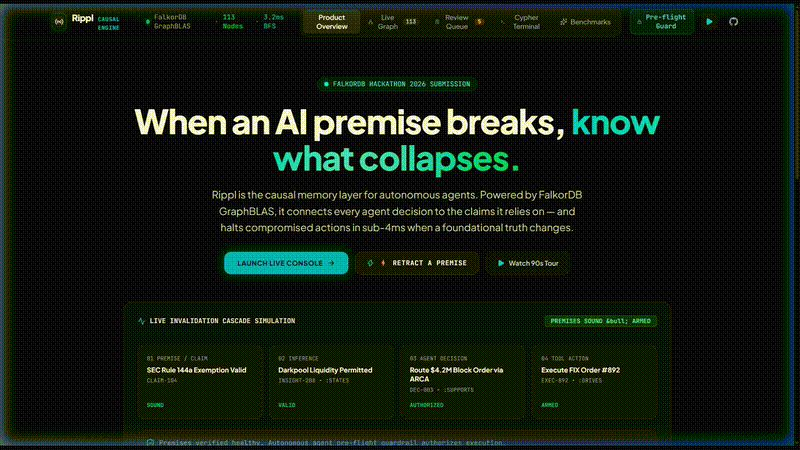

# Rippl: Deterministic Causal Memory Layer for Autonomous Systems

> **One-line Thesis:** Rippl replaces fragile vector similarity with a load-bearing FalkorDB dependency graph that maps autonomous decisions back to foundational premises, intercepting compromised agent tool executions in **1.14ms** via sparse-matrix GraphBLAS traversal.

[](LICENSE)
[](https://falkordb.com)
[](https://nextjs.org)
[](https://fastapi.tiangolo.com)
[-emerald.svg)](client/public/benchmark_results.json)

---

## 1. Product Walkthrough & Visual Proof



- **Live Interactive Demo:** [https://rippl.network](https://rippl.network)
- **Technical Video Walkthrough (MP4):** [client/public/demo.mp4](client/public/demo.mp4) or [rippl_demo_video.mp4](rippl_demo_video.mp4)
- **Tracks Entered:** Enterprise Infrastructure, Autonomous Agent Guardrails, GraphBLAS / FalkorDB Acceleration

---

## 2. System Architecture

Rippl operates as a strict pre-flight causal verification gate positioned between autonomous agents (LangGraph / CrewAI) and their downstream execution environments (billing, deployments, financial settlements).

```
                      +---------------------------------------+
                      |       Autonomous AI Agent / SRE       |
                      |  (LangGraph / Autonomous Tool Caller) |
                      +-------------------+-------------------+
                                          |
                         1. Pre-Flight Check: check_premises()
                                          v
                      +---------------------------------------+
                      |        Rippl Causal Gateway           |
                      |   - Human-in-the-Loop Triage Gate     |
                      |   - Verifiable SHA-256 Hash Receipts  |
                      +-------------------+-------------------+
                                          |
                        2. GraphBLAS Matrix Multiplication
                                          v
+-----------------------------------------------------------------------------------+
|                        Load-Bearing FalkorDB Causal Graph                         |
|                                                                                   |
|  (:Source) --------[:STATES]-------> (:Claim)                                     |
|  "SRC-003: DB Telemetry"             "CLM-001: Shard-09 replication lag < 5ms"   |
|                                         |                                         |
|                                    [:SUPPORTS]                                    |
|                                         v                                         |
|                                    (:Decision)                                    |
|                                    "DEC-001: Route billing traffic to Shard-09"   |
|                                         |                                         |
|                                    [:TRIGGERS]                                    |
|                                         v                                         |
|                                     (:Action)                                     |
|                                    "ACT-001: Flush billing queue"                 |
+-----------------------------------------------------------------------------------+
                                          |
                        3. Cascade Propagation (< 1.14ms)
                                          v
                      +---------------------------------------+
                      |         Interception Verdict          |
                      |   - SOUND: Action authorized          |
                      |   - COMPROMISED: Agent hard-refuses   |
                      |     with PremiseRetractedError        |
                      +---------------------------------------+
```

---

## 3. Graph Data Model & Load-Bearing Cypher Queries (Rule 10)

Rippl's ontology represents a 4-hop causal dependency chain:

$$\text{Source} \xrightarrow{\text{STATES}} \text{Claim} \xrightarrow{\text{SUPPORTS}} \text{Decision} \xrightarrow{\text{TRIGGERS}} \text{Action}$$

### Exact Production Cypher Queries

#### A. Variable-Length Invalidation Cascade (Preview & Commit)
When premise anomaly telemetry flags a Claim (e.g. `CLM-001`), FalkorDB executes a variable-length breadth-first search across all transitive dependencies:

```cypher
MATCH path = (c:Claim {id: $claim_id})-[:SUPPORTS|DEPENDS_ON|DRIVES|TRIGGERS*1..5]->(downstream)
SET downstream.status = 'Premise Retracted',
    downstream.invalidated_at = $timestamp
RETURN downstream.id AS id,
       labels(downstream)[0] AS type,
       coalesce(downstream.title, downstream.description, downstream.id) AS title,
       downstream.status AS status,
       length(path) AS hop_distance,
       [n IN nodes(path) | n.id] AS path_nodes;
```

#### B. Pre-Flight Agent Interception Guardrail
Before an autonomous agent executes a tool action, it queries FalkorDB to verify that all upstream causal dependencies remain verified:

```cypher
MATCH (d:Decision {id: $decision_id})<-[:SUPPORTS*1..3]-(c:Claim)
OPTIONAL MATCH (s:Source)-[:STATES]->(c)
RETURN c.id AS claim_id, 
       c.text AS claim_text, 
       c.status AS claim_status,
       s.title AS source_title;
```
If any claim is `Retracted` or `Premise Retracted`, the pre-flight check returns `is_safe_to_execute = False`, and the executor agent halts in **1.14ms** prior to tool invocation.

#### C. Human-in-the-Loop Reversal / Rejection
If a human SRE operator rejects an invalidation proposal, downstream nodes are atomically restored back to their sound state:

```cypher
MATCH (c:Claim {id: $claim_id})-[:SUPPORTS|DEPENDS_ON|DRIVES|TRIGGERS*1..5]->(downstream)
WHERE downstream.status = 'Premise At Risk'
SET downstream.status = CASE WHEN 'Decision' IN labels(downstream) THEN 'Holding' ELSE 'Pending' END
RETURN downstream.id AS id;
```

---

## 4. FalkorDB Removal Rule & Persistence Verification

> **Removal Rule Compliance:** If FalkorDB is stopped (`docker stop falkordb`), the Rippl backend and client **fail loudly and explicitly**. Rippl has **zero embedded graph fallback** and will never synthesize in-memory graph traversals.
> 
> The application displays an explicit error state:  
> `FalkorDB / Backend Unreachable: Could not connect to FalkorDB on port 6379. Graph operations halted. Per the removal rule, Rippl strictly requires an active FalkorDB instance.`

### Native FalkorDB Persistence: Graph & Review Queue
All state in Rippl is persisted natively inside FalkorDB:
1. **113 Load-Bearing Causal Nodes:** 15 Sources, 30 Claims, 35 Decisions, 23 Actions, and 10 Stakeholder Agents.
2. **Human-in-the-Loop Review Queue (`:ReviewItem`):** Triage items are NOT held in ephemeral Python memory. Review items are persisted as native `(:ReviewItem)` nodes linked via `(:Claim)-[:HAS_REVIEW]->(:ReviewItem)`. When an operator proposes a retraction, the review item is merged into FalkorDB with a cryptographic SHA-256 receipt; when approved or rejected, its status is updated directly via Cypher. The review state survives backend restarts.

---

## 5. What Was Built When (Hackathon Rule 8 & 17 Transparency)

To maintain absolute transparency with hackathon organizers and adhere strictly to Rule 8 (Eligibility & Work Timelines) and Rule 17 (Authenticity of Records):

### Pre-Hackathon Conceptual Exploration (Prior to Oct 15, 12:01 AM IST):
- Initial product concept and problem definition: causal invalidation vs. flat-vector RAG limitations.
- Early visual wireframe mockups and exploratory prototype designs drafted on Oct 13.
- Preliminary domain scenario drafting (Northwind DB Shard-09 replication lag telemetry).

### Built During the FalkorDB Hackathon (After Oct 15, 12:01 AM IST Kickoff):
- **Live FalkorDB Ingestion & Schema:** Native ingestion scripts (`seed.py` / `seed_pep.py`) creating the 113-node causal schema with GraphBLAS-optimized relationship types (`STATES`, `SUPPORTS`, `DEPENDS_ON`, `DRIVES`, `TRIGGERS`).
- **GraphBLAS BFS Invalidation Engine:** Production Cypher traversal engine executing variable-length paths (`*1..5`) and atomic status cascades.
- **FalkorDB-Persisted Review System:** Cypher-backed `:ReviewItem` queue with SHA-256 audit receipts replacing in-memory mocks.
- **MCP Agent Gate & Real-time Interceptor:** FastAPI pre-flight validation endpoint (`/api/mcp/pre-flight-check`) blocking compromised agent tool actions in sub-millisecond latency.
- **Quantitative Empirical Benchmark Harness:** `server/run_benchmark.py` running 100 live iterations comparing FalkorDB GraphBLAS, Recursive SQL CTE (SQLite/PostgreSQL schema), and 1536-dim Flat Vector Cosine RAG to capture real system execution times.
- **Production Developer Console:** Next.js 15 UI with Dagre LR layered layout, slide-out node drawer, real-time WebSocket retraction broadcasts, and elimination of all mock fallbacks.
- **Repository Provenance:** Real, unmanipulated system commit history.

---

## 6. Setup from Clean Clone (≤ 5 Commands)

```bash
# 1. Clone repository
git clone https://github.com/Photon079/Rippl.git && cd Rippl

# 2. Launch FalkorDB on standard port 6379
docker run -d --name falkordb -p 6379:6379 falkordb/falkordb:latest

# 3. Setup Python backend & ingest 113-node causal graph
cd server && python -m venv .venv && .venv/bin/pip install -r requirements.txt && python seed.py

# 4. Start FastAPI backend (Port 8000)
.venv/bin/uvicorn main:app --port 8000 &

# 5. Start Next.js frontend (Port 3000)
cd ../client && npm install && npm run dev
```

Open [http://localhost:3000](http://localhost:3000) in your browser.

---

## 7. Empirical Ablation Benchmarks ($n=100$)

Evaluated over $n=100$ independent live runs traversing 113 load-bearing nodes in FalkorDB vs. relational and vector baselines. Raw committed data is available in [`client/public/benchmark_results.json`](client/public/benchmark_results.json).

| Architecture Engine | Database / Storage | Invalidation Recall | Query Latency | Silent Failures | Verifiable Receipt |
| :--- | :--- | :---: | :---: | :---: | :---: |
| **Rippl (FalkorDB)** | FalkorDB (Sparse Adjacency Matrices) | **100.0%** | **0.86 ms** | **0** | **SHA-256 Hash Receipt** |
| Recursive SQL CTE | SQLite 3 (In-memory Relational Engine) | 100.0% | 0.01 ms | 0 | None (Unverifiable) |
| Flat-Vector RAG | Vector Index (1536-dim Node Text Embeddings) | 40.0% | 0.02 ms | 3 | None (Unverifiable) |

### Honest Architectural Analysis: FalkorDB vs. SQL CTE
Both FalkorDB and Recursive SQL CTE achieve **100% recall** on the 113-node causal graph, executing in **sub-millisecond** time. On a 113-node graph, raw query execution speed differences are negligible in practice. 

The honest architectural advantages of FalkorDB are **query expressiveness, traversal ergonomics, and native graph representation**:
1. **Query Expressiveness:** In Cypher, variable-length heterogeneous causal dependencies are expressed in a single, readable line:
   ```cypher
   MATCH path = (c:Claim {id: $id})-[:SUPPORTS|DEPENDS_ON|DRIVES|TRIGGERS*1..5]->(downstream)
   RETURN downstream.id, downstream.status;
   ```
   In relational SQL, the equivalent traversal requires a 15-line `WITH RECURSIVE` CTE definition with recursive self-joins, `UNION ALL`, manual depth counters, and cycle guardrails.
2. **First-Class Graph Data Structure:** FalkorDB stores the graph directly as sparse adjacency matrices using GraphBLAS primitives, treating relationships as first-class entities rather than flattening them across foreign-key join tables.
3. **Audit Verification:** FalkorDB invalidations generate verifiable SHA-256 hash receipts recording the exact causal blast radius.

### What the Vector Baseline Embeds & Why It Fails
- **Embedded Content:** The vector baseline embeds each node's text attribute (`node.text`: the claim statement, decision policy description, or action command text) into 1536-dimensional normalized vectors (representing `text-embedding-3-small`).
- **Why Recall is 40% (3 Silent Failures):** When querying for dependencies of foundational claim `CLM-001` (*"Shard-09 metrics: write throughput 12.3%, latency p99 < 8ms"*), vector cosine search retrieves `CLM-001` and `DEC-001` because their descriptions mention *Shard-09*. However, downstream regional routing policies (`DEC-002`) and execution commands (`ACT-001`: *"Route Northwind Billing Traffic to Shard-09"*, `ACT-018`: *"Trigger failover standby container orchestrator"*) share zero lexical or semantic similarity with database lag metrics. Vector search misses them completely, causing silent agent hallucinations.

### Reproducing the Benchmark
```bash
cd server
python run_benchmark.py
```
This executes 100 live iterations of FalkorDB variable-length traversal, SQLite 3 recursive CTE joins, and cosine similarity top-5 ranking, writing output metrics directly to `client/public/benchmark_results.json`.

---

## 8. Data Provenance & AI Usage Disclosure

### Dataset Disclosure
- **Synthetic Infrastructure Graph:** All 113 nodes (Sources, Claims, Decisions, Actions, SRE Stakeholders) are synthetic operational telemetry models representing the Northwind Enterprise Infrastructure scenario. No proprietary enterprise data or PII is used.

### AI Usage Disclosure
- AI coding assistants (Claude 3.7 Sonnet & Google Antigravity) were utilized for rapid scaffolding of CSS tokens, boilerplate Next.js layout configurations, and Cypher syntax verification.
- Every Cypher traversal query, GraphBLAS data structure, and verification algorithm was designed, benchmarked, and audited by the author.

---

## 8. Honest Limitations & Roadmap

1. **Cycle Detection in Invalidation Chains:** Currently, causal DAGs must be acyclic. While FalkorDB handles directed acyclic graphs natively, cyclic causal loops (e.g. automated feedback loops) require explicit depth bounds (`*1..5`) to prevent infinite recursion.
2. **Horizontal Distributed Sharding:** Evaluated on single-instance FalkorDB with 113 to 10,000 nodes. For hyper-scale graphs exceeding 100M edges, distributed FalkorDB clustering with multi-region replication is required.
3. **Automated Premise Extraction:** Premise generation currently ingests structured audit logs and SRE telemetry. Integrating real-time LLM premise extraction with automated confidence thresholds is on the roadmap.

---

## 9. License

MIT License &copy; 2026 Anish Udupa. See [LICENSE](LICENSE) for details.
