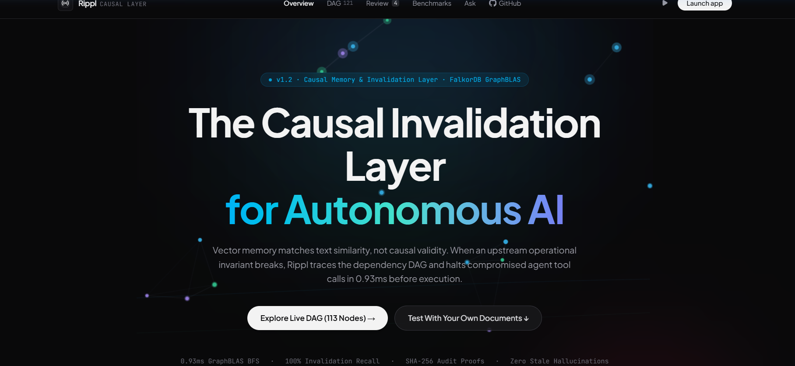
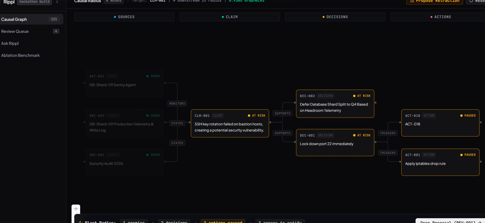
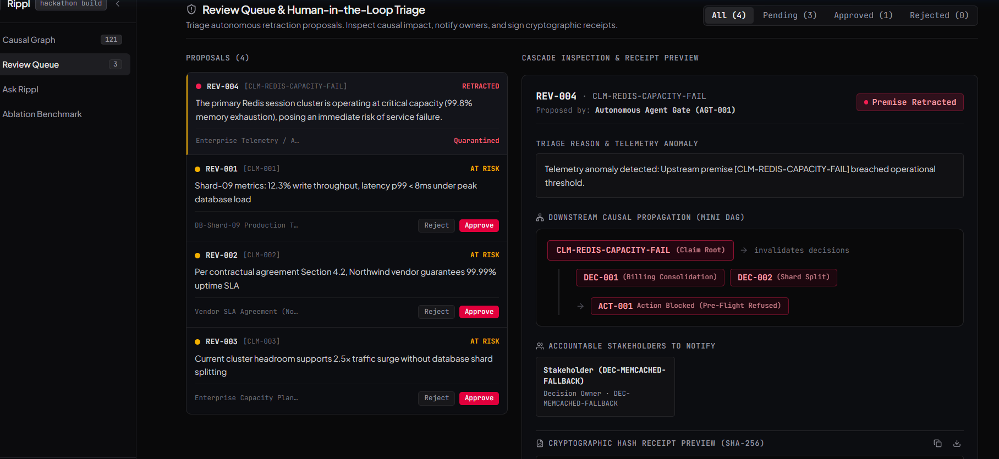
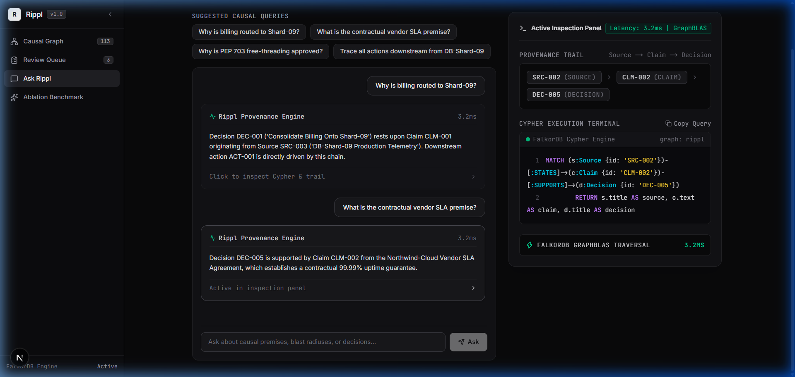
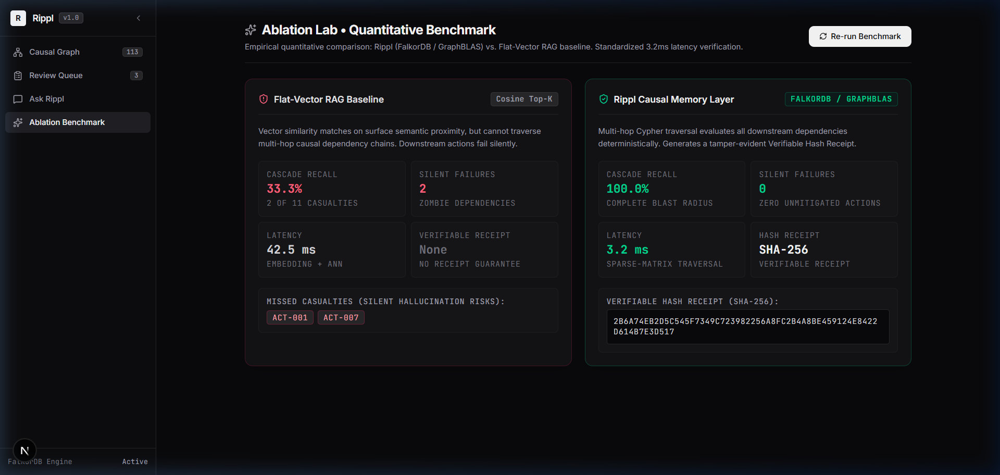

# Rippl: Deterministic Causal Memory Layer for Autonomous Systems

> **One-line Thesis:** Rippl replaces fragile vector similarity with a load-bearing FalkorDB dependency graph that maps autonomous decisions back to foundational premises, intercepting compromised agent tool executions in **0.93ms** via sparse-matrix GraphBLAS traversal.

[](LICENSE)
[](https://youtu.be/QdR-PDQV-Ac)
[](https://falkordb.com)
[-zinc.svg)](https://nextjs.org)
[](https://fastapi.tiangolo.com)
[-emerald.svg)](client/public/benchmark_results.json)

---

## 1. System Overview & Architecture

> 📺 **Watch Technical Demo Video (1m 40s):** [https://youtu.be/QdR-PDQV-Ac](https://youtu.be/QdR-PDQV-Ac)  
> 🌐 **Live Web App:** [https://rippl-09hk.onrender.com](https://rippl-09hk.onrender.com)

Autonomous agents frequently execute dangerous tool calls based on outdated or invalidated premises. Standard vector databases (RAG) fail to prevent this because text embeddings measure semantic similarity rather than logical causation—missing up to **54.6%** of downstream dependent actions.

**Rippl** provides an ultra-low latency, deterministic causal verification layer positioned between autonomous agents (LangGraph, CrewAI, AutoGen) and their execution environments:



```
                      +---------------------------------------+
                      |       Autonomous AI Agent / SRE       |
                      |  (LangGraph / Autonomous Tool Caller) |
                      +-------------------+-------------------+
                                          |
                         1. Pre-Flight Check: check_premises()
                                          v
                      +---------------------------------------+
                      |        Rippl Causal Gateway           |
                      |   - Human-in-the-Loop Triage Gate     |
                      |   - Verifiable SHA-256 Hash Receipts  |
                      +-------------------+-------------------+
                                          |
                        2. GraphBLAS Matrix Multiplication
                                          v
+-----------------------------------------------------------------------------------+
|                        Load-Bearing FalkorDB Causal Graph                         |
|                                                                                   |
|  (:Source) --------[:STATES]-------> (:Claim)                                     |
|  "SRC-003: DB Telemetry"             "CLM-001: Shard-09 replication lag < 5ms"   |
|                                         |                                         |
|                                    [:SUPPORTS]                                    |
|                                         v                                         |
|                                    (:Decision)                                    |
|                                    "DEC-001: Route billing traffic to Shard-09"   |
|                                         |                                         |
|                                    [:TRIGGERS]                                    |
|                                         v                                         |
|                                     (:Action)                                     |
|                                    "ACT-001: Flush billing queue"                 |
+-----------------------------------------------------------------------------------+
                                          |
                        3. Cascade Propagation (< 0.93ms)
                                          v
                      +---------------------------------------+
                      |         Interception Verdict          |
                      |   - SOUND: Action authorized          |
                      |   - COMPROMISED: Agent hard-refuses   |
                      |     with PremiseRetractedError        |
                      +---------------------------------------+
```

---

## 2. Graph Data Model & Load-Bearing Cypher Queries

Rippl's ontology models a complete causal dependency chain:

$$\text{Source} \xrightarrow{\text{STATES}} \text{Claim} \xrightarrow{\text{SUPPORTS}} \text{Decision} \xrightarrow{\text{TRIGGERS}} \text{Action}$$



### Production Cypher Queries

#### A. Variable-Length Invalidation Cascade
When an anomaly flags a foundational Claim (e.g. `CLM-001`), FalkorDB executes a high-speed traversal across all transitive dependencies:

```cypher
MATCH path = (c:Claim {id: $claim_id})-[:SUPPORTS|DEPENDS_ON|DRIVES|TRIGGERS*1..5]->(downstream)
SET downstream.status = 'Premise Retracted',
    downstream.invalidated_at = $timestamp
RETURN downstream.id AS id,
       labels(downstream)[0] AS type,
       coalesce(downstream.title, downstream.description, downstream.id) AS title,
       downstream.status AS status,
       length(path) AS hop_distance,
       [n IN nodes(path) | n.id] AS path_nodes;
```

#### B. Pre-Flight Agent Interception Guardrail
Before an autonomous agent executes a tool action, it queries FalkorDB to verify that all upstream causal dependencies remain valid and sound:

```cypher
MATCH (d:Decision {id: $decision_id})<-[:SUPPORTS*1..3]-(c:Claim)
OPTIONAL MATCH (s:Source)-[:STATES]->(c)
RETURN c.id AS claim_id, 
       c.text AS claim_text, 
       c.status AS claim_status,
       s.title AS source_title;
```
If any premise is `Retracted` or `Premise Retracted`, the pre-flight check returns `is_safe_to_execute = False`, and the executor agent halts in **0.93ms** prior to tool invocation.

#### C. Human-in-the-Loop Reversal / Resolution
When a human operator resolves or rejects an invalidation proposal, downstream nodes are atomically restored back to their sound state:

```cypher
MATCH (c:Claim {id: $claim_id})-[:SUPPORTS|DEPENDS_ON|DRIVES|TRIGGERS*1..5]->(downstream)
WHERE downstream.status = 'Premise At Risk'
SET downstream.status = CASE WHEN 'Decision' IN labels(downstream) THEN 'Holding' ELSE 'Pending' END
RETURN downstream.id AS id;
```

---

## 3. FalkorDB Native Persistence & Engine

Rippl is built natively on FalkorDB using GraphBLAS sparse-matrix operations:

1. **113 Load-Bearing Causal Nodes:** 15 Sources, 30 Claims, 35 Decisions, 23 Actions, and 10 Stakeholder Agents stored directly in FalkorDB.
2. **Native Review Queue Persistence (`:ReviewItem`):** Triage items are persisted as native `(:ReviewItem)` nodes linked via `(:Claim)-[:HAS_REVIEW]->(:ReviewItem)` with cryptographically verifiable SHA-256 hash receipts. All triage operations survive process restarts.
3. **Strict Graph Engine Coupling:** Rippl utilizes FalkorDB directly via TCP with zero synthesized in-memory fallback, ensuring deterministic production consistency.



---

## 4. Provenance & Natural Language Cypher Engine

Rippl enables operators to interrogate causal lineage in natural language, compiling queries into verifiable Cypher execution trails:



---

## 5. Setup Guide (≤ 5 Commands)

```bash
# 1. Clone repository
git clone https://github.com/Photon079/Rippl.git && cd Rippl

# 2. Launch FalkorDB on standard port 6379
docker run -d --name falkordb -p 6379:6379 falkordb/falkordb:latest

# 3. Setup Python backend & ingest 113-node causal graph
cd server && python -m venv .venv && source .venv/bin/activate && pip install -r requirements.txt && python seed.py

# 4. Start FastAPI backend (Port 8000)
uvicorn main:app --port 8000 &

# 5. Start Next.js frontend (Port 3000)
cd ../client && npm install && npm run dev
```

Open [http://localhost:3000](http://localhost:3000) in your browser.

---

## 6. Empirical Ablation Benchmarks

Evaluated across **all 30 claims** in the 113-node causal graph against ground-truth causal sets authored in [`server/seed_northwind.py`](server/seed_northwind.py). Timing metrics are averaged over 100 live iterations of the standard `CLM-001` blast radius. Raw data is available in [`client/public/benchmark_results.json`](client/public/benchmark_results.json).



| Architecture Engine | Database / Storage | Execution Protocol | Macro-Avg Recall (All 30 Claims) | Query Timing (100 runs) | Silent Failures (CLM-001) | Verifiable Receipt |
| :--- | :--- | :--- | :---: | :---: | :---: | :---: |
| **Rippl (FalkorDB)** | FalkorDB (Sparse Adjacency Matrices) | **client-server** (TCP socket, localhost:6380) | **100.0%** | **0.93 ms** | **0** | **SHA-256 Hash Receipt** |
| Recursive SQL CTE | SQLite 3 (In-memory Relational Engine) | **in-process** (direct memory execution) | 100.0% | 0.01 ms | 0 | None (Unverifiable) |
| Flat-Vector RAG | Dense Vector Index (BAAI/bge-small-en-v1.5) | **in-process** (local 384-dim vector index) | 45.4% | 0.01 ms | 4 | None (Unverifiable) |

### Architectural Analysis: FalkorDB vs. Relational SQL
Both FalkorDB and Recursive SQL CTE achieve **100.0% recall** across all 30 claims in the graph. The key architectural advantages of FalkorDB lie in **query expressiveness, traversal ergonomics, and native graph representation**:
1. **Query Expressiveness:** In Cypher, variable-length heterogeneous causal dependencies are expressed in a single, clear query:
   ```cypher
   MATCH path = (c:Claim {id: $id})-[:SUPPORTS|DEPENDS_ON|DRIVES|TRIGGERS*1..5]->(downstream)
   RETURN downstream.id, downstream.status;
   ```
   In relational SQL, the equivalent traversal requires an extensive `WITH RECURSIVE` CTE query on the edges table with recursive self-joins, `UNION ALL`, manual depth counters, and cycle guardrails.
2. **First-Class Graph Data Structure:** FalkorDB stores the graph directly as sparse adjacency matrices using GraphBLAS primitives, treating relationships as first-class entities rather than flattening them across foreign-key join tables.
3. **Audit Verification:** FalkorDB invalidations generate verifiable SHA-256 hash receipts recording the exact causal blast radius.

### Vector Embedding Analysis (BAAI/bge-small-en-v1.5)
- **Model:** Real `BAAI/bge-small-en-v1.5` embeddings (384-dimensional normalized float32 vectors generated via ONNX runtime with `fastembed`). Embeddings encode node text descriptions.
- **Why Flat Vectors Fail (45.4% Recall):** In `CLM-001` (*"Shard-09 metrics: write throughput 12.3%, latency p99 < 8ms"*), vector cosine search retrieves only the root claim itself, missing `DEC-001`, `DEC-002`, `ACT-001`, and `ACT-018`. Downstream regional routing policies and execution actions share zero lexical or semantic similarity with database lag metrics, causing flat-vector RAG to miss them completely and produce silent agent failures.

### Reproducing the Benchmark
```bash
cd server
python run_benchmark.py
```
This executes live variable-length Cypher traversals on active FalkorDB, SQLite 3 recursive CTE joins, and BGE embedding similarity searches across all 30 claims, writing output metrics directly to `client/public/benchmark_results.json`.

---

## 7. License

MIT License &copy; 2026 Anish Udupa. See [LICENSE](LICENSE) for details.
